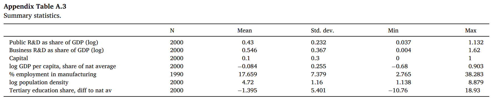
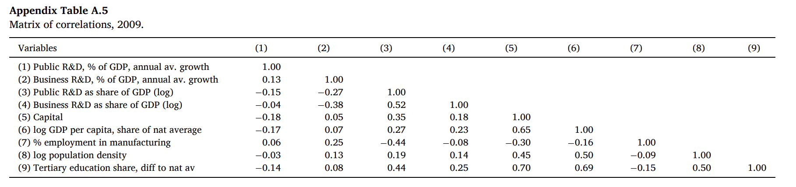
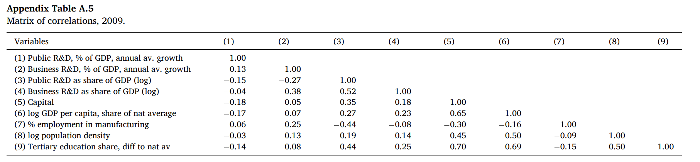

# Pakker vi har brukt

```{r}
library(tidyverse)
library(modelr)
library(flextable)
library(plm)
library(vtable)
library(rstatix)
library(modelsummary)

options(paged.print = FALSE)
```

```{r}
load(file = 'eu0823.RData', verbose = TRUE)
```

# Sammendrag

Fitjar (2025) undersøker hvordan offentlige midler til forskning og utvikling (FoU) fordeles mallom europeiske regioner, og om fordelingen bidrar til å opprettholde eller forsterke regionale forskjeller. Studien bruker data fra Eurostat for 200 europeiske regioner i perioden 2009-2018 og sammenligner utviklingen i offentlig FoU med FoU i næringslivet.

Resultatene viser at mer utviklede regioner mottar mer oppentlige FoU-midler, særlig i sammenheng med høyere humankapital og mer FoU i næringslivet. Studien finner beta-konvergens i offentlig FoU, som betyr at regioner med lave utdanningsnivåer har hatt raskere vekst. Likevel finner den ikke sigma-konvergens, altså en reduksjon i den samlede spredningen mellom regionene. For næingslivets FoU finner studien begge former for konvergens. Fitjar konkluderer med at offentlig FoU-finansiering i stor grad kanaliseres til allerede ressurssterke regioner og dermed kan bidra til å opprettholde eller forsterke regionale forskjeller.

# Systemet med NUTS regioner i EUs regional-data

NUTS står for "Nomenclature of Territorial Units for Statistics" og er EUś system for å dele land inn i geografiske områder til statistiske formål. Systemet brukes av Eurostat for å organisere regional statistikk og gjøre det lettere å sammenligne blant annet økonomi, befoklning og forskningsaktivitet mellom regioner i ulike land. (KILDE EUROSTAT!!!)

Inndelingen er hierarkisk og består av tre nivåer. NUTS 1 omfatter store sosioøkonomiske regioner, NUTS 2 omfatter mindre regioner som er særlig viktige for regionalpolitikk, og NUTS 3 omfatter små regioner for mer dataljerte analyser. En NUTS 1-region deles dermes inn i NUTS 2-regioner, som igjen deles inn i NUTS 3-regioner.

Inndelingen bygger så langt som mulig på eksisterende administrative grenser. Det finnes også veiledende befolkningsgrenser for hvert nivå for å gjøre regionene mer sammenlignbare. NUTS gjør det mulig å undersøke forskjeller innad i land som ellers kan bli skjult når man bare sammenligner nasjonale gjennomsnitt.

# Beskrivende statistikk og korrelasjonsmatrise

## Bekrivende statistikk

```{r}
# Lager logaritmerte variabler
eu0823 <- eu0823 |>
  mutate(
    GDP_log = log(GDP),
    Density_log = log(Density)
  )

# Velger variablene til tabellen
variabler <- eu0823 |>
  select(pub_RD, priv_RD, Capital, GDP_log,
         Manuf, Density_log, edu)

# Beregner beskrivende statistikk
beskrivende <- vtable::st(
  variabler,
  summ = c(
    "notNA(x)",
    "mean(x)",
    "sd(x)",
    "min(x)",
    "quantile(x, probs = 0.25, na.rm = TRUE)",
    "quantile(x, probs = 0.75, na.rm = TRUE)",
    "max(x)"
  ),
  summ.names = c(
    "N", "Mean", "Std. Dev.", "Min",
    "Pctl. 25", "Pctl. 75", "Max"
  ),
  digits = 3,
  out = "return"
)

flextable::flextable(beskrivende) |>
  flextable::theme_booktabs() |>
  flextable::autofit()
```

Beskrivende statistikk Fitjar



### Sammenligning beskrivende statistikk

Vårt datasett har 3136 observasjoner, mens Fitjar (2025) har 2000 for de fleste variablene. Datasettet vårt dekker perioden 2008-2023, mens artikkelens hovedanalyse dekker 2009-2018. Gjennomsnittet for logaritmert BNP er -0,084 i begge tabellene, og utdanningsvariabelen har også et relativt likt gjennomsnitt. Befokningstettheten er noe høyere hoss oss, mens andelen hovedstadsregioner er litt lavere.

Industrivariabelen skiller seg mest ut, med et stanadardavvik på 14,1 hos oss mot 7,379 i artikkelen. Maksimumsverdien på 116 bør undersøkes dersom variabelen måler en prosentandel. FoU-variablene kan ikke sammenlignes direkte, siden artikkelen bruker logaritmerte verdier. Samlet ligner datasettene på flere områder, men forskjeller i periode, utvalg, og variabelbehandling begrenser sammenlignbarheten.

# Korrelasjonsmatrise 2009

```{r}
# Velger bare observasjoner fra 2009 og de aktuelle variablene
korrelasjon_2009 <- eu0823 |>
  filter(time == 2009) |>
  select(pub_RD, priv_RD, Capital, GDP_log,
         Manuf, Density_log, edu) |>
  rstatix::cor_mat() |>
  rstatix::pull_lower_triangle(diag = TRUE)

# Viser resultatet som en tabell
flextable::flextable(korrelasjon_2009) |>
  flextable::theme_booktabs() |>
  flextable::autofit()
```

Korrelasjonsmatrise Fitjar



## Sammenligning korrelasjonsmatrise 2009

Korrelasjonsmatrisen vår viser flere likheter med tabell A5 i Fitjar (2025). Korrelasjonen mellom offentlig og privat FoU er 0,50 hos oss mot 0,52 i artikkelen. Sammenhengen mellom hovedstadregion og BNP er også relativt lik, med 0,66 hos oss mot 0,65 i artikkelen. Utdanning er positivt korrelert med BNP i begge datasettene, men sammenhengen er noe svakere hos oss med 0,62 mot 0,69 i artikkelen.

Industrivariabelen viser tydelige foskjeller. Korrelasjonen med offentlig FoU er omtrent 0 hos oss mot -0,44 i artikkelen. Sammenhengene med BNP, utdanning og befolkningstetthet er positive hos oss og nagative i artikkelem. Forskjellene kan ha sammenheng med at industrivariabelen har ulik fordeling i datasttene. Samlet samsvarer flere av sammenhengene godt, men særlig industrivariabelen skiller seg ut. Artikkelens bruk av logaritmerte FoU-variabler begrenser også den direkte sammenlignbarheten.

# 5) Sammenligning korrelasjonsmatrise 2009-2023 og 2009

## Korrelasjonsmatrise fra 2008-2023

```{r}
# Velger perioden og variablene
korrelasjon_alle <- eu0823 |>
  filter(time >= 2008, time <= 2023) |>
  select(pub_RD, priv_RD, Capital, GDP_log,
         Manuf, Density_log, edu) |>
  rstatix::cor_mat() |>
  rstatix::pull_lower_triangle(diag = TRUE)

# Viser korrelasjonsmatrisen som en tabell
flextable::flextable(korrelasjon_alle) |>
  flextable::theme_booktabs() |>
  flextable::autofit()
```

## Korrelasjonsmatrise Table A5 Fitjar



## Sammenligning

Når vi sammenligner vår korrelasjonsmatrise for 2008-2023 med Fitjar (2025) matrise for 2009 i tabell A.5, finner vi både likheter og forskjeller. Korrelasjonen mellom utdanning og BNP er 0,72 hos oss mot 0,69 hos Fitjar. Dette er nærmere artikkelens verdi enn vår korrelasjon på 0,62 for 2009. Sammenhengen mellom offentlig og privar FoU samsvarer derimot dårligere. Den er 0,41 for hele perioden, sammenlignet med 0,52 hos Fitjar og 0,50 i våre 2009-data. Industrivariabelen har fortsatt flere sammenhenger med motsatt fortegn sammenlignet med artikkelen. Hele perioden gir dermed samsvar for enkelte korrelasjoner, men ikke et entydig bedre samsvar samlet sett.

# 6) Variablene GDP, Manuf og Destiny

Variabalen GPD måler regionens BNP per innbygger relativt til landsgjennomsnittet. I analysen brukes den naturlige logariten av dette forholdet. Variabelen viser dermed regionens økonomiske nivå sammenlignet med landet den tilhører.

Variabelen Manuf måler hvor stor prosentandel av den samlede sysselsettingen i regionen som er innen industriproduksjon. Variabelen beskriver hvor indusripreget regionens næringsstrukttur er.

Destiny måler befolkningstettheten, altså innbyggere per kvadrarkilometer. I analysen brukes den naturlige logaritmen av befolkningstetthete.

# 7) NUTS 2 regioner GPD, Manuf og Destiny

```{r}
# Beregner gjennomsnitt for hver region
regionverdier <- eu0823 |>
  group_by(geo, name) |>
  summarise(
    across(
      c(GDP, Manuf, Density),
      ~ mean(.x, na.rm = TRUE)
    ),
    .groups = "drop"
  )

# Finner fem h\u00f8yest og fem laveste for hver variabel
topp_bunn <- regionverdier |>
  pivot_longer(
    cols = c(GDP, Manuf, Density),
    names_to = "Variabel",
    values_to = "Verdi"
  ) |>
  filter(is.finite(Verdi)) |>
  group_by(Variabel) |>
  group_modify(~ bind_rows(
    .x |>
      slice_max(Verdi, n = 5, with_ties = FALSE) |>
      mutate(Gruppe = "H\u00f8yest"),
    .x |>
      slice_min(Verdi, n = 5, with_ties = FALSE) |>
      mutate(Gruppe = "Lavest")
  )) |>
  ungroup() |>
  select(Variabel, Gruppe, geo, name, Verdi)

# Viser resultatene
flextable::flextable(topp_bunn) |>
  flextable::colformat_num(j = "Verdi", digits = 2) |>
  flextable::autofit()
```

# GPD

De høyeste verdiene for GDP finnes i hovedstadregioner, mens de laveste finnes i Sør-Italia, nordøstlige Romania og nordvestlige Bulgaria. Dette virkeer rimelig ut fra at hovedstadregioner ofte samler mye økonomisk aktivitet. Variabelen måler BNP per innbygger relativt til eget landsgjennomsnitt. Bratislavský kraj sin verdi på omtrent 2,39 betyr dermed at BNP per inbygger ligger rundt 139 prosent over landsgjennomsnittet. Rangeringen viser derfor ikke nødvendigvis hvilke regioner som er rikest i Europa i absolutte tall.

## Manuf

De høyeste verdiene finnes blant annet i norditalienske regioner og Sluttgart, mens de laveste finnes i mindre by-, øy-, og fjellregioner. Rangeringen kan virke rimelig, men verdiene samsvarer ikke uten videre med artikkelens definisjon av Manuf som prosentandelen sysselsatte innen industriproduskjon. Lombardia har et gjennomsnitt på 112,4 som ikke kan være en prosentandel. Måleenheten og beregningen i datasettet bør derfor undersøkes før tallene tolkes som industriandeler.

## Density

De høyeste verdiene finnes i avgrensede byregioner, mens de laveste finnnes i større områder i Sverige og Finland. Dette virker rimelig fordi byområder har mange innbyggere på lite areal, mens større nordiske regioner kan ha mye ubebodd areal. Melilla har en gjennomsnitlig befolkningstetthet på 6038 mens Ovre Norrland har omtrent 3,38.

# 8) Land regioner og tidsperiode Fitjar

Fitjar (2025) undersøker 200 regioner, 20 europeiske land i perioden 2009-2018.

# 9) Land regioner og tidsperiode vårt datasett

```{r}
eu0823 |>
  summarise(
    Antall_land = n_distinct(substr(geo, 1, 2)),
    Antall_regioner = n_distinct(geo),
    Første_år = min(time, na.rm = TRUE),
    Siste_år = max(time, na.rm = TRUE),
    Antall_observasjoner = n()
  ) |>
  flextable::flextable() |>
  flextable::autofit()
```

Vårt datasett omfatter 196 NUTS-2 regioner i 17 land i perioden 2008-2023, totalt 3136 observasjoner. Fitjar (2025) undersøker 200 regioner, 20 europeiske land i perioden 2009-2018, med 2000 observasjoner. Vårt datasett har dermed fem færre land og fire færre regioner, men dekker 16 år sammenlignet med Fitjar sine 10 år. Den lengre tidsperioden gir flere observasjoner, selv om den geografiske dekningen er mindre. Forskjellene i utvalg og tidsperiode kan bidra til at resultatene våre avviker fra artikkelen.

# 10) Dropper 5 regioner

```{r}
eu0823 |>
  filter(geo %in% c("EL42", "EL62", "ES63", "ES64", "RO22")) |>
  distinct(geo, name) |>
  flextable::flextable() |>
  flextable::autofit()
```

```{r}
eu0823 <- eu0823 |> 
  filter(!geo %in% c("EL42", "EL62", "ES63", "ES64", "RO22"))
```

Det kan være fornuftlig å utelate regionene dersom de har særtrekk eller peroblemer med datakvaliteten som gjør dem lite sammenlignbare med resten av regionene. Samtidig er lave eller høye verdier ikke alene en god nok begrunnelse til å fjerne observasjoner siden de kan gjenspeile reelle regionale forskjeller. Utelatelsen reduserer også den geografiske dekningen og kan påvirke resultatet. Valget bør derfor begrunnes ut fra regionenes egenskaper og datakvalitet, og helst vurderes med å sammenligne analysen både med og uten disse regionene.

# 11) Modell 2: Regresjonsanalyse

For å undersøke hvilke faktorer som henger sammen med offentlige FoU, beregner vi gjennomsnittsverdier for hver NUTS2-region i perioden 2008-2023. Etter at fem regioner er fjernet i oppgave 10, består datasettet av 191 regioner.

```{r}
# Lager logaritmer og beregner gjennomsnitt per region
eu_mean <- eu0823 |>
  mutate(
    log_pub_RD = log(pub_RD),
    log_priv_RD = log(priv_RD)
  ) |>
  group_by(geo) |>
  summarise(
    country = substr(first(geo), 1, 2),
    across(
      c(log_pub_RD, log_priv_RD,
        GDP_log, Capital, Manuf,
        Density_log, edu),
      ~ mean(.x, na.rm = TRUE)
    ),
    .groups = "drop"
  )

# Kontrollerer antall regioner
nrow(eu_mean)

```

Vi gjennomfører deretter sju regresjonsanalyser med offentlig FoU som avhengig variabel. I den første modellen inkluderer vi bare BNP, før vi gradvis legger til land, privat FoU, hovedstadsstatus, industri, befolkningstetthet og utdanning. Dette gjør det mulig å undersøke hvordan sammenhengene endrer seg når vi kontrollerer for flere forhold.

```{r}
# Modell 1: BNP
m1 <- lm(log_pub_RD ~ GDP_log, data = eu_mean)

# Modell 2: Legger til land
m2 <- lm(log_pub_RD ~ GDP_log + country,
         data = eu_mean)

# Modell 3: Legger til privat FoU
m3 <- update(m2, . ~ . + log_priv_RD)

# Modell 4: Legger til hovedstadsregion
m4 <- update(m3, . ~ . + Capital)

# Modell 5: Legger til industri
m5 <- update(m4, . ~ . + Manuf)

# Modell 6: Legger til befolkningstetthet
m6 <- update(m5, . ~ . + Density_log)

# Modell 7: Legger til utdanning
m7 <- update(m6, . ~ . + edu)


```

Resultatene fra de sju regresjonsmodellene er samlet i tabellen nedenfor, slik at vi kan sammenligne koeffisientenes fortegn og statistiske signifikans med Fitjar (2025).

```{r}

# Samler modellene i en tabell
modelsummary::modelsummary(
  list(
    "(1)" = m1, "(2)" = m2,
    "(3)" = m3, "(4)" = m4,
    "(5)" = m5, "(6)" = m6,
    "(7)" = m7
  ),
  coef_omit = "^country",
  statistic = "({statistic})",
  stars = TRUE,
  output = "flextable"
) |>
  flextable::theme_booktabs() |>
  flextable::autofit()

```

Regresjonsresultatene viser at BNP har en positiv og signifikant sammenheng med offentlig FoU i de første modellene. I modell 1 er koeffisienten 0,857 (p \< 0,001). Når flere forklaringsvariabler inkluderes, endrer sammenhengen seg. I modell 4 er koeffisienten blirr negativ (-0,048), men er ikke lenger statistisk signifikant. I modell 7 er koeffisienten enda mer redusert til -0,757 og signifiknat på 1%-nivå. Dette viser at sammenhengen mellom BNP og offentlig FoU endrer seg når vi kontrollerer for andre regionale forhold.

I modell 4 har privat FoU en positiv koeffisient på 0,133, som er signifikant på 10%-nivå. Hovedstadsstatus har også en positiv og signifikant sammenheng med offentlig FoU, med en koeffisient på 0,911 (p \< 0,001). I modell 7 er derimot verken privat FoU (0,018) eller hovedstadsstatus (0,043) statistisk signifikante. Utdanning har en positiv og statistisk signifikant sammenheng med offentlig FoU i modell 7, med en koeffisient på 0,089 (p \< 0,001). Industri og befolkningstetthet er ikke statistisk signifikante i den siste modellen.

## Sammenligning med Fitjar (2025)

Resulatene samsvarer på flere omrdåer med Fitjar (2025). Begge analysene finner en negativ og signifikant sammenheng mellom BNP og offentlig FoU i den siste modellen, mens utdanning har en positiv og signifikant sammenheng. Privat FoU og industri er derimot signifikante hos Fitjar. Funnene støtter dermed delvis konklusjonen om at regioner med mye ressurser får mer offentlig FoU.

# 12) Vurdering av robuste standardfeil

For å undersøke om vi bør bruke robuste standardfeil, ser vi på residualplottet fra modell 7 og gjennomfører en alternativ White-test. Testen brukes for å undersøke om det er tegn til heteroskedastisitet i modellen.

```{r}

# Lager residualplott for modell 7
plot(m7, which = 1)

```

```{r}

# Henter residualer og predikerte verdier
testdata <- tibble(
  fit = fitted(m7),
  residual = residuals(m7)
)

# Alternativ White-test
white_test <- lm(
  I(residual^2) ~ fit + I(fit^2),
  data = testdata
)

# Viser resultatene
summary(white_test)

```

For å tolke resulatene bruker vi F-testens p-verdi for å undersøke om de predikerte verdiene samlet har sammenheng med de kvadrerte residualene.

**Nullhypotesen (H₀):** De predikerte verdiene og deres kvadrat forklarer ikke variasjonen i de kvadrerte residualene.

**Alternativ hypotese (H₁):** Minst en av variablene har en sammenheng med de kvadrerte residualene.

Residualplottet viser noe variasjon i spredningen av residualene, men ingen tydelig systematisk endring. Den alternative White-testen gir en p-verdi på 0,3169, som er høyere enn signifikansnivået på 0,05. Vi forkaster derfor ikke nullhypotesen. Testen gir derfor ikke statistisk signifikante tegn til heteroskedastisitet, og det er ikke tydelig behov for robuste standardfeil.

# 13) Beregning av gjennomsnittlig vekst i offentlig FoU

For å undersøke utviklingen i offentlig FoU beregner vi årlig vekst for hver NUTS2-region. Veksten beregnes som differansen mellom logaritmen til offentlig FoU i et bestemt år og året før, ved hjelp av dplyr :: lag( ).

```{r}
# Beregner årlig vekst
eu_vekst <- eu0823 |>
  arrange(geo, time) |>
  group_by(geo) |>
  mutate(
    vekst_pub = log(pub_RD) -
      log(dplyr::lag(pub_RD))
  ) |>
  ungroup()

# Kontrollerer veksten for én region
eu_vekst |>
  filter(geo == "AT11") |>
  select(time, pub_RD, vekst_pub)

```

```{r}
# Beregner samlet vekst per region
vekst_region <- eu_vekst |>
  group_by(geo) |>
  summarise(
    vekst_pub = sum(vekst_pub, na.rm = TRUE),
    .groups = "drop"
  )

# Kontrollerer resultatene
summary(vekst_region$vekst_pub)

```

Deretter beregner vi gjennomsnittlig årlig vekst i offentlig FoU for perioden 2010-2023. Dette gir en gjennomsnittsverdi for hver av de 191 regionene.

Resultatet viser en gjennomsnittlig årlig vekst på omtrent 0,78%. Veksten varierer mellom regionene, fra omtrent -20,4% til 11,8% målt som logaritmiske vekstrater. Dette viser at noen regionr har hatt en nedgang i offentlig FoU, men andre har hatt vekst.

# 14) Regresjonsanalyse av vekst i offentlig FoU

I denne oppgaven skal vi undersøke om regioner som starter på et lavt nivå, vokser raskere enn regioner som starter på et høyt nivå. Vi er da nødt til å koble gjennomsnittlig årlig vekst fra oppgave 13 sammen med nivået på offentlig FoU i 2009. Dette gjør det mulig å undersøke om regioner med lavere FoU i startåret har hatt høyere vekst i perioden 2010-2023.

```{r}
# Henter offentlig FoU i startåret 2009
startverdier <- eu0823 |>
  filter(time == 2009) |>
  transmute(
    geo,
    country = substr(geo, 1, 2),
    log_pub_RD = log(pub_RD)
  )

# Slår sammen startverdier og vekst
vekst_data <- vekst_region |>
  left_join(startverdier, by = "geo")

# Kontrollerer antall regioner
nrow(vekst_data)

```

Deretter estimerer vi to regresjonsmodeller. Den første undersøker sammenhengen mellom offentlig FoU i startåret og den gjennomsnittlige veksten. I den andre modellen inkluderer vi også land for å kontrollere for forskjeller mellom landende.

```{r}
# Modell 4: Uten landeffekter
mod3a <- lm(
  vekst_pub ~ log_pub_RD,
  data = vekst_data
)

# Modell 5: Med landeffekter
mod3b <- lm(
  vekst_pub ~ log_pub_RD + country,
  data = vekst_data
)

```

Resultatene fra de to regresjonene samles i en tabell for å undersøke koeffisentenes fortegn og statistiske signifikans.

```{r}
# Samler regresjonene i en tabell
modelsummary::modelsummary(
  list(
    "(1)" = mod3a,
    "(2)" = mod3b
  ),
  coef_omit = "^country",
  statistic = "({statistic})",
  stars = c(
    "+" = 0.1,
    "*" = 0.05,
    "**" = 0.01,
    "***" = 0.001
  ),
  output = "flextable"
) |>
  flextable::theme_booktabs() |>
  flextable::autofit()

```

Regresjonsanalysen undersøker om regioner med lavere offentlig FoU i 2009 har hatt høyere samlet vekst i perioden 2008-2023. Resultatene viser en negativ og signifikant sammenheng mellom offentlig FoU i startåret og den gjennomsnittlige veksten. I modell 1 er koeffisenten -0,011 (p \< 0,001), mens den i modell 2 er -0,016 (p \< 0,001) når vi kontrollerer for land.

Dette samsvarer med Fitjar (2025), som også finner negative og signifikante koeffisienter på -0,006 og -0,010. Begge analysene viser dermed at regioner med lavere offentlig FoU i utgangspunktet har hatt høyere vekst.

# 15) Regresjonsanayse av vekst i privat FoU

For å undersøke utviklingen i privat FoU beregner vi først den årlige veksten for hver NUTS-region. Dette gjøres ved å ta forskjellen mellom logaritmen til privat FoU i et bestemt år og året før. Vi bruker dplyr::lag( ) for å hente verdien fra tidligere år.

Deretter beregner vi gjennomsnittlig årlig vekst i perioden 2010-2023. Dette gir en vekstverdi for hver region, som vi senere bruker i regresjonsanalysen.

```{r}
# Beregner årlig vekst i privat FoU
eu_vekst <- eu_vekst |>
  arrange(geo, time) |>
  group_by(geo) |>
  mutate(
    vekst_priv = log(priv_RD) -
      log(dplyr::lag(priv_RD))
  ) |>
  ungroup()

# Beregner samlet vekst per region
vekst_priv_region <- eu_vekst |>
  group_by(geo) |>
  summarise(
    vekst_priv = sum(vekst_priv, na.rm = TRUE),
    .groups = "drop"
  )

# Kontrollerer resultatene
summary(vekst_priv_region$vekst_priv)

```

For å undersøke om regioner med lavere privat FoU har hatt høyere vekst, trenger vi nivået på privat FoU i startåret 2009. Vi henter derfor verdiene fra 2009 og kobler dem sammen med den gjennomsnittlige veksten for hver region.

Vi får da et datasett som viser hvor my privat FoU hver region hadde i starten av perioden og hvordan den har utviklet seg i årene etterpå.

```{r}
# Henter privat FoU fra startåret 2009
start_priv <- eu0823 |>
  filter(time == 2009) |>
  transmute(
    geo,
    log_priv_RD = log(priv_RD)
  )

# Legger til privat FoU og veksten i datasettet
vekst_data <- vekst_data |>
  left_join(vekst_priv_region, by = "geo") |>
  left_join(start_priv, by = "geo")

# Kontrollerer antall regioner
nrow(vekst_data)

```

Vi gjennomfører videre to regresjonsanalyser. Den avhengige variabelen er gjennomsnittlig årlig vekst, mens forklaringsvariabelen er privat FoU i startåret 2009.

Den første modellen undersøker sammenhengen uten å ta henysn til forskjeller mellom land. I den andre modellen inkluderer vi landeeffekter for å undersøke om sammenhengen fortsatt finnes når vi kontrollerer for slike forskjeller.

```{r}
# Modell 3: Privat FoU uten landeffekter
mod3aPriv <- lm(
  vekst_priv ~ log_priv_RD,
  data = vekst_data
)

# Modell 4: Privat FoU med landeffekter
mod3bPriv <- lm(
  vekst_priv ~ log_priv_RD + country,
  data = vekst_data
)

```

Resultatene fra de fire regresjonsmodellene samles i en tabell ved hjelp av modelsummary( ). Dette gjør det mulig å sammenligne utviklingen i offentlig og privat FoU, både med og uten landeffekter.

# 16) Ubetinget konvergens

```{r}
# Samler offentlig og privat FoU i én tabell
modelsummary::modelsummary(
  list(
    "Offentlig (1)" = mod3a,
    "Offentlig (2)" = mod3b,
    "Privat (3)" = mod3aPriv,
    "Privat (4)" = mod3bPriv
  ),
  coef_omit = "^country",
  gof_map = c("nobs", "r.squared"),
  statistic = "({statistic})",
  stars = c(
    "+" = 0.1,
    "*" = 0.05,
    "**" = 0.01,
    "***" = 0.001
  ),
  output = "flextable"
) |>
  flextable::theme_booktabs() |>
  flextable::autofit()

```

Startnivået er negativt og signifikant i alle fire modellene. Regioner med lite FoU i 2009 har altså hatt høyere vekst enn regioner med mye, noe som betyr ubetinget beta-konvergens. Uten landeffekter er konvergensen klart sterkere for privat FoU (-0,439) enn for offentlig FoU (-0,133). Med landeffekter er de nesten like (-0,222 og -0,228). For offentlig FoU blir konvergensen sterkere når vi kontrollerer for land, altså skjer den mest innad i land.

Dette samsvarer godt med Fitjar (Table 2). Han finner også negative og signifikante koeffisienter i alle fire modellene. Uten landeffekter er konvergensen sterkere for privat FoU (-0,017 mot -0,006), og med landeffekter er de like (-0,010 for begge). Også hos Fitjar blir koeffisienten for offentlig FoU sterkere med landeffekter. Koeffisientene hans er mindre fordi han bruker årlig gjennomsnittlig vekst og en kortere periode (2009–2018), mens vi bruker samlet vekst 2008–2023. Mønsteret er likevel det samme, så vår analyse viser det samme som Fitjar.

# 17) Betinget konvergens

Fitjar estimerer en betinget konvergensmodell, der veksten i FoU 2009-2023 forkalres med startnivået i 2009 og regionale kjennetegn. Vi estimerer to modeller med vekst i offentlig Fou og tre modeller med vekst i privat Fou som avhengi variabel. Alle modellene har landfaste effekter.

```{r}
# Vekst: sum av årlige endringer i log (alle tilgjengelige år)
eu17 <- eu0823 |>
  filter(!geo %in% c("EL42", "EL62", "ES63", "ES64", "RO22")) |>
  mutate(aar = if (inherits(time, "Date")) lubridate::year(time) else as.numeric(time))
vekst <- eu17 |>
  arrange(geo, aar) |>
  group_by(geo) |>
  mutate(
    dl_pub  = log(pub_RD)  - dplyr::lag(log(pub_RD)),
    dl_priv = log(priv_RD) - dplyr::lag(log(priv_RD))
  ) |>
  summarise(
    d_pub_RD  = sum(dl_pub,  na.rm = TRUE),
    d_priv_RD = sum(dl_priv, na.rm = TRUE),
    .groups = "drop"
  )
```

```{r}
# Startverdier i 2009
start_2009 <- eu17 |>
  filter(aar == 2009) |>
  transmute(
    geo, country,
    log_pub_RD  = log(pub_RD),
    log_priv_RD = log(priv_RD),
    GDP_log, Capital, Manuf, Density_log, edu
  )

# Slå sammen vekst og startverdier
cs <- left_join(vekst, start_2009, by = "geo")

cs
```

I modell 5 legger vi til en interaksjon mellom log(priv_RD) og log(GDP). Den tester om konvergensen i privat FoU går like raskt i rike og fattige regioner. Er interaksjonen positiv, blir effekten av startnivået svakere i rike regioner. Da tar fattige regioner med lite FoU igjen raskere. Er den negativ, er det de rike regionene som konvergerer raskest. Oppgaveteksten nevner log Public R&D × log GDP, men vi har fulgt Table 3 i Fitjar, som bruker privat FoU.

```{r}
# Vekst i offentlig FoU
mod6_pub1 <- lm(d_pub_RD ~ log_pub_RD + log_priv_RD + GDP_log + Capital +
                  Manuf + Density_log + country, data = cs)
mod6_pub2 <- update(mod6_pub1, . ~ . + edu)

# Vekst i privat FoU
mod6_priv1 <- lm(d_priv_RD ~ log_pub_RD + log_priv_RD + GDP_log + Capital +
                   Manuf + Density_log + country, data = cs)
mod6_priv2 <- update(mod6_priv1, . ~ . + edu)
mod6_priv3 <- update(mod6_priv2, . ~ . + log_priv_RD:GDP_log)
```

```{r}
#| label: tbl-mod6
#| tbl-cap: "OLS, vekst i FoU 2009–2023 (betinget konvergens). Tilsvarer Table 3 i Fitjar (2025)."
modelsummary(
  list(
    "(1)" = mod6_pub1, "(2)" = mod6_pub2,
    "(3)" = mod6_priv1, "(4)" = mod6_priv2, "(5)" = mod6_priv3
  ),
  coef_omit = "country",
  coef_rename = c(
    "log_pub_RD" = "log(pub_RD)", "log_priv_RD" = "log(priv_RD)",
    "GDP_log" = "log(GDP)", "Density_log" = "log(Density)",
    "log_priv_RD:GDP_log" = "log(priv_RD) x log(GDP)"
  ),
  statistic = "statistic",
  stars = c("+" = 0.1, "*" = 0.05, "**" = 0.01, "***" = 0.001),
  gof_map = c("nobs", "adj.r.squared", "logLik", "F"),
  notes = "t-verdier i parentes. Kol. 1–2: vekst i offentlig FoU. Kol. 3–5: vekst i privat FoU. Alle modeller har landfaste effekter."
)
```

Fitjar finner også at startnivået er negativt og signifikant både for offentlig og privat FoU, så hovedfunnet om betinget konvergens er det samme. Koeffisientene hans er mindre fordi han bruker årlig gjennomsnittlig vekst, mens vi bruker samlet vekst over perioden. Det er likevel noen forskjeller. Fitjar finner at BNP har negativ effekt på veksten i offentlig FoU, mens befolkningstetthet og utdanning har positiv effekt. Hos oss er ingen av disse signifikante. For privat FoU finner Fitjar at industriandel er positiv og signifikant, og at BNP bare er svakt signifikant i én modell. Hos oss er BNP signifikant positiv i alle tre modellene, mens industri ikke er signifikant. Forskjellene kan skyldes at vi bruker en lengre periode (2008–2023 mot 2009–2018), ingen britiske data og at Fitjar måler BNP og utdanning relativt til nasjonalt gjennomsnitt.

# 18) Test for heteroskedastisitet

Vi tester da tre modeller for privat FoU for heteroskedastisitet med Whites alterantive test. De kvadreete residualene regresseres på depredikerte verdiene og de predikerte verdiene i andre. H0 er at feilleddet er homoskedastisk.

```{r}
# Whites alternative test
white_alt <- function(mod) {
  u2   <- resid(mod)^2
  yhat <- fitted(mod)
  aux  <- lm(u2 ~ yhat + I(yhat^2))
  LM   <- nobs(mod) * summary(aux)$r.squared
  tibble(
    LM      = LM,
    p_verdi = pchisq(LM, df = 2, lower.tail = FALSE)
  )
}

bind_rows(
  "Modell (3)" = white_alt(mod6_priv1),
  "Modell (4)" = white_alt(mod6_priv2),
  "Modell (5)" = white_alt(mod6_priv3),
  .id = "Modell"
) |>
  mutate(across(where(is.numeric), \(x) round(x, 3)))
```

Alle tre modellene har p-verdier under 0,01 (LM mellom 11,6 og 13,3). Vi forkaster derfor H0 om homoskedastisitet. Variansen til feilleddet avhenger av de predikerte verdiene, og det betyr at de vanlige standardfeilene kan være feil. Estimatene er fortsatt forventningsrette, men t-verdiene og signifikansen kan være misvisende. Vi bør derfor bruke robuste standardfeil, noe vi gjør i oppgave 19.

# 19) Robuste standardfeil

Siden testen i oppgave 18 viste heteroskedastisitet, estimerer vi modellene fra oppgave 17 på nytt med robuste standardfeil (HC3).

```{r}
#| label: tbl-mod6-robust
#| tbl-cap: "OLS, vekst i FoU 2009-2023 med robuste standardfeil (HC3)."
modelsummary(
  list(
    "(1)" = mod6_pub1, "(2)" = mod6_pub2,
    "(3)" = mod6_priv1, "(4)" = mod6_priv2, "(5)" = mod6_priv3
  ),
  vcov = "HC3",
  coef_omit = "country",
  coef_rename = c(
    "log_pub_RD" = "log(pub_RD)", "log_priv_RD" = "log(priv_RD)",
    "GDP_log" = "log(GDP)", "Density_log" = "log(Density)",
    "log_priv_RD:GDP_log" = "log(priv_RD) x log(GDP)"
  ),
  statistic = "statistic",
  stars = c("+" = 0.1, "*" = 0.05, "**" = 0.01, "***" = 0.001),
  gof_map = c("nobs", "adj.r.squared", "logLik", "F"),
  notes = "Robuste t-verdier (HC3) i parentes. Alle modeller har landfaste effekter."
)
```

Robuste standardfeil endrer bare t-verdiene, ikke estimatene. De fleste t-verdiene blir litt mindre, men hovedfunnene står seg. Startnivået er fortsatt negativt og signifikant for både offentlig og privat FoU, og log(GDP) er fortsatt positiv og signifikant i modellene for privat FoU. Det eneste som endres er de svake resultatene: log(priv_RD) i modell 2 er ikke lenger signifikant på 10 %-nivå. Konklusjonene endres altså ikke, noe som gjør resultatene mer troverdige. Fitjar bruker også robuste standardfeil i sine analyser.

# 20) Konklusjon

Fitjar (2025) undersøker (1) hvilke regioner som tiltrekker seg offentlig FoU, og (2) om forskjellene mellom regionene i offentlig og privat FoU har blitt mindre over tid. Han finner at mer utviklede regioner får mer offentlig FoU, hovedsakelig fordi de har mer privat FoU og høyere utdanningsnivå. Han finner også beta-konvergens i både offentlig og privat FoU, men sigma-konvergens bare i privat FoU.

Våre resultater gir i stor grad det samme bildet. I modell 2 (oppgave 11) henger BNP positivt sammen med offentlig FoU alene, men effekten forsvinner når vi kontrollerer for hovedstad, og blir negativ når utdanning tas med. Utdanning er den sterkeste forklaringsvariabelen, noe som støtter Fitjars tolkning om at humankapital, og ikke rikdom i seg selv, trekker til seg offentlig FoU. Vi finner også signifikant beta-konvergens i både offentlig og privat FoU, både ubetinget (oppgave 16) og betinget (oppgave 17), og resultatene holder med robuste standardfeil (oppgave 19).

Det er likevel noen forskjeller. I de betingede modellene finner Fitjar at BNP, tetthet og utdanning påvirker veksten i offentlig FoU, mens vi ikke finner dette. For privat FoU finner vi en sterkere positiv BNP-effekt enn Fitjar, men ingen effekt av industriandel. Forskjellene kan skyldes lengre periode (2008–2023 mot 2009–2018), manglende britiske data, ulik interpolering og at Fitjar måler BNP og utdanning relativt til nasjonalt gjennomsnitt. Samlet sett støtter funnene likevel Fitjars hovedkonklusjon: FoU-nivåene konvergerer, men offentlig FoU følger i stor grad regioner med høy humankapital.

## Bruk av KI

Vi har brukt KI som hjelpemiddel i arbeidet med oppgaven. KI ble brukt til å feilsøke R-kode og chunks, løse problemer med tegnkoding og merge-konflikter.
